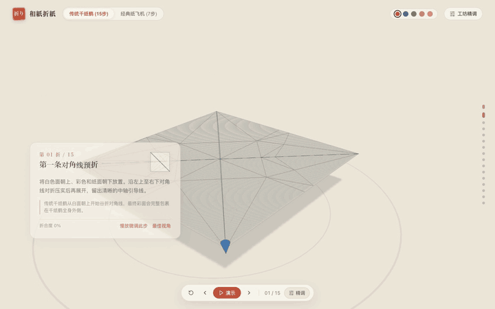
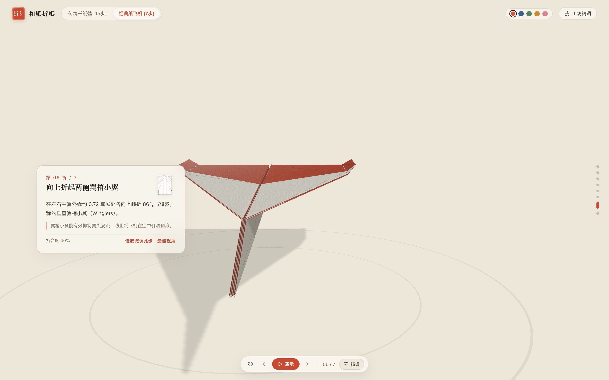

# Washi Origami · Origami Atelier

> One sheet of paper, fifteen creases. Fold it in the browser, one step at a time, until a crane spreads its wings.

A scroll-driven 3D origami atelier. An exact rigid-origami kinematics engine turns a 2D crease pattern into a 3D paper model frame by frame, wrapped in washi-paper rendering and Japanese editorial layout — from a flat sheet to a finished piece, fold by fold.



## Features

- **Two complete models** — a traditional crane (15 folds) and a classic dart paper airplane (7 folds), each step with its own crease diagram, instructions, and tips.
- **Zero-strain rigid origami engine** — every frame solves rigid transforms for each facet, so edge lengths stay exactly correct at any moment of the fold. No stretched paper, ever.
- **Scroll-driven narrative** — the hero screen shows the finished piece; scrolling down unfolds it step by step, and the chapter rail jumps straight to any fold.
- **Washi paper rendering** — procedurally generated bokashi gradients, paper fibers, and gold-leaf flecks, with two-sided materials, soft shadows, and a display plinth.
- **Atelier controls** — per-step 0–100% scrubbing, whole-sequence progress, playback speed (0.5×–2×), five camera presets, auto-follow camera, X-ray mode, a rear-view picture-in-picture window, crease toggling, and scroll-wheel zoom.
- **Traditional palette** — switch paper color between vermilion, ultramarine, matcha, golden brown, and pale sakura at any time.
- **Free inspection** — drag to rotate to any angle and view the finished piece 360°.

## Screenshots

| Crane · Hero | Crane · Folding |
| --- | --- |
|  |  |

| Atelier controls | Paper airplane · Finished |
| --- | --- |
|  |  |

### Paper airplane · Winglets



## Quick start

Requires Node.js 18+.

```bash
npm install
npm run dev      # local dev server, http://localhost:5173 by default
npm run build    # type check + production build into dist/
npm run preview  # preview the production build
```

## Usage

1. On the hero screen, click **Unfold step by step**, or simply scroll down — the model folds as you scroll.
2. Click **Atelier** in the top bar or **Tune** in the bottom dock to open the control panel.
3. The bottom dock resets to the flat sheet, steps backward/forward, and starts the continuous demo.
4. Switch between **Crane** and **Paper airplane** in the top bar, or pick a paper color from the top-right swatches.
5. Hold the left mouse button and drag on the canvas to rotate the model 360°.

## How it works

A pure frontend project — no backend and no image assets. Crease patterns, geometry, and textures are all generated at runtime.

- **React 19 + TypeScript** — UI and state
- **Three.js** — 3D rendering, lighting, shadows, and cameras
- **Vite** — development and build
- **lucide-react** — icons

### The origami engine

`src/engine/origamiEngine.ts` provides model-agnostic kinematics primitives:

1. **Crease-pattern modeling** — each model is defined by 2D vertices, triangle facets, and creases (valley or mountain).
2. **Stepwise rigid folding** — each crease rotates around its own line according to step progress, keeping every facet rigid with zero scaling.
3. **Facet vertex solving** — vertex positions on each facet are solved with three-sphere intersection and barycentric interpolation, so shared edges between facets line up exactly.
4. **Stack disambiguation** — smoothly blended offsets separate coincident facets during a fold, removing Z-fighting without any popping.
5. **Strain validation** — the engine continuously reports the maximum relative edge-length error (`maxEdgeStrainPct`), which stays at `0.000%` for the finished pieces.

Models live in `src/models/` and only describe creases and steps — no rendering logic. Adding a new piece means writing one more crease pattern.

## Project structure

```text
.
├── index.html
├── src
│   ├── main.tsx
│   ├── App.tsx                 # Scroll narrative, chapters, atelier panel, state
│   ├── index.css               # Washi palette and editorial layout
│   ├── components
│   │   └── OrigamiViewport.tsx # Three.js scene, washi textures, camera, input
│   ├── engine
│   │   └── origamiEngine.ts    # Rigid-origami kinematics and 3D solving
│   └── models
│       ├── crane.ts            # Crane: 32 vertices / 48 facets / 15 folds
│       └── paperAirplane.ts    # Paper airplane: 7 folds
└── docs
    └── screenshots
```

## Controls

| Action | Location | Description |
| --- | --- | --- |
| Scroll | Page | Fold along the chapter progress |
| Drag | Canvas | Rotate the view 360° |
| Atelier | Top bar / bottom dock | Open the control panel |
| Step scrub | Panel | Manually drive the current fold from 0–100% |
| Demo | Bottom dock | Play the whole fold automatically |
| Camera | Panel | Isometric / top / front / side / back |
| X-ray | Panel | Show stacked layers translucently |
| Rear view | Panel | Picture-in-picture view from behind |
| Wheel zoom | Panel | Enable scroll-wheel zooming of the model |

## Notes

- The models target isometric rigid origami: geometric correctness and a readable fold sequence rather than millimeter-accurate paper thickness and elasticity.
- The experience is designed desktop-first, with basic support on narrow screens.

## License

MIT
