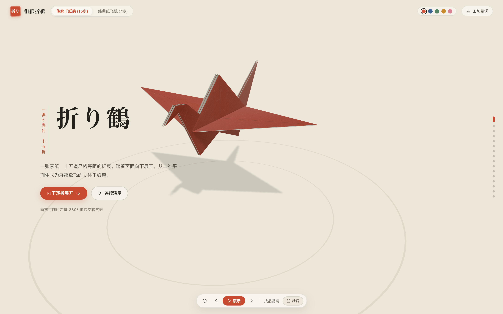
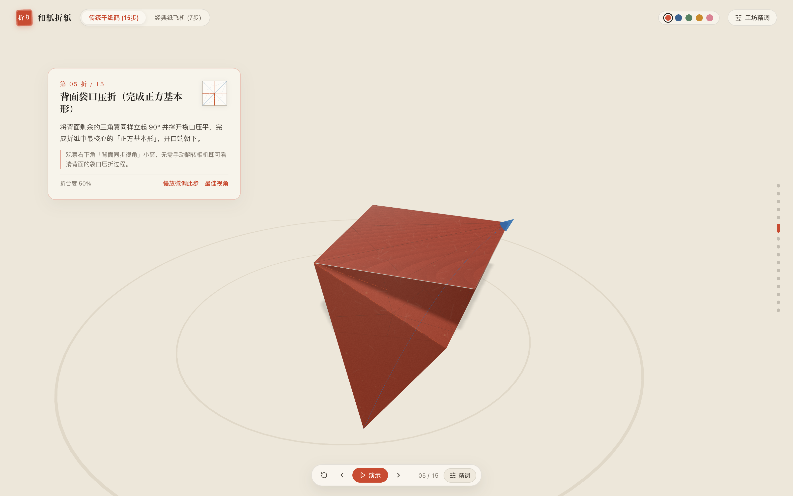
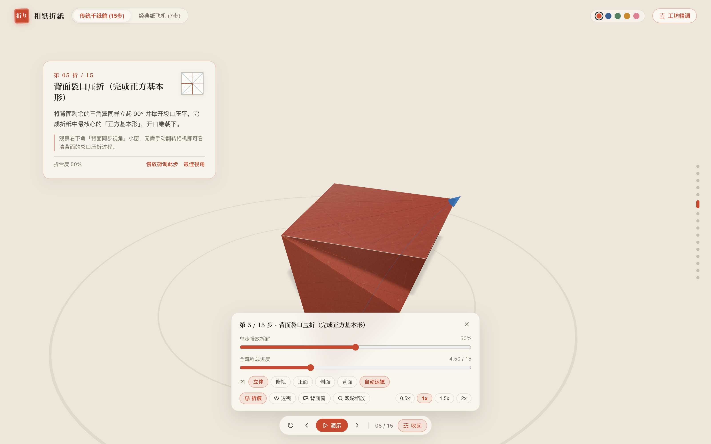
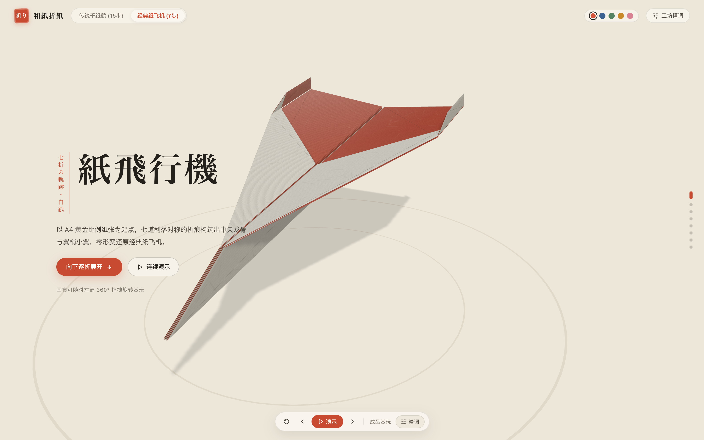

# 和紙折紙 · Origami Atelier

> 一张素纸，十五道折痕。在浏览器里，把它一折一折折成展翅欲飞的立体千纸鹤。

一个滚动驱动的 3D 折纸展示工坊：以精确的刚性折纸运动学，把二维折痕图逐帧还原为 3D 纸模型，配合和纸质感渲染与日式编辑排版，从平纸到成品，一折一折展开给你看。

A scroll-driven 3D origami atelier that folds a flat sheet into a crane, one crease at a time — built on an exact rigid-origami kinematics engine with washi-paper rendering.


## 特性

- **两件作品，完整折序** — 传统千纸鹤（15 折）与经典尖头纸飞机（7 折），每一步都有折痕图、文字说明与要领提示。
- **零形变的刚性折纸引擎** — 每一帧都求解各面片的刚体变换，保证任意折叠瞬间边长误差恒为 0，不会出现纸张被「拉伸」的穿帮。
- **滚动叙事** — 首屏是成品展示，向下滚动即逐折展开；右侧章节轨道可直达任意一步。
- **和纸质感渲染** — 程序化生成渐变、纸纤维、金箔斑点纹理，正反双面材质、软阴影与展台圆环。
- **工坊精调** — 单步 0–100% 慢放、全流程进度、播放速度（0.5×–2×）、五种相机预设、自动运镜、透视、背面小窗、折痕显隐、滚轮缩放。
- **传统色彩** — 朱赤、群青、若竹、山吹、薄樱五色和纸随时切换。
- **自由赏玩** — 任意角度拖拽旋转，成品 360° 观看。

## 截图

| 千纸鹤 · 首屏 | 千纸鹤 · 逐折展开 |
| --- | --- |
|  |  |

| 工坊精调面板 | 纸飞机 · 成品 |
| --- | --- |
|  |  |

### 纸飞机 · 翼梢小翼


## 快速开始

需要 Node.js 18+。

```bash
npm install
npm run dev      # 本地开发，默认 http://localhost:5173
npm run build    # 类型检查 + 生产构建，输出到 dist/
npm run preview  # 预览生产构建
```

## 使用方式

1. 首屏点击「向下逐折展开」，或直接在页面上向下滚动，模型会随滚动进度逐步折叠。
2. 点击顶部「工坊精调」或底部「精调」，打开控制面板做精细调整。
3. 底部胶囊栏可重置回平纸、上一步 / 下一步、连续演示。
4. 顶部切换「传统千纸鹤 / 经典纸飞机」，或点选右侧色点更换纸色。
5. 在画布上按住左键拖拽，可 360° 旋转观察。

## 技术实现

纯前端，无后端、无贴图资源 —— 折痕、几何、纹理都在运行时计算生成。

- **React 19 + TypeScript** — 界面与状态
- **Three.js** — 3D 渲染、光照、阴影与相机
- **Vite** — 开发与构建
- **lucide-react** — 图标

### 折纸引擎

`src/engine/origamiEngine.ts` 提供与具体模型无关的运动学原语：

1. **折痕图建模** — 每个模型由二维顶点、三角形面片与折痕（谷折 / 山折）定义。
2. **逐步刚体折叠** — 每道折痕按步骤进度绕折痕线旋转，面片保持刚性，不产生任何缩放。
3. **面片顶点求解** — 通过三球交会 / 重心坐标插值求出每个顶点在各面片上的位置，保证面片之间共享边完全吻合。
4. **堆叠消歧** — 对折叠中重合的面片施加平滑的层间偏移，既消除 Z-fighting，又不会出现跳变。
5. **形变校验** — 引擎实时计算最大边长相对误差（`maxEdgeStrainPct`），成品恒为 `0.000%`。

模型位于 `src/models/`，只描述折痕与步骤，不含渲染逻辑，新增作品只需再写一份折痕图。

## 项目结构

```text
.
├── index.html
├── src
│   ├── main.tsx
│   ├── App.tsx                 # 滚动叙事、章节、工坊面板与状态编排
│   ├── index.css               # 和纸配色与版面样式
│   ├── components
│   │   └── OrigamiViewport.tsx # Three.js 场景、和纸纹理、相机与交互
│   ├── engine
│   │   └── origamiEngine.ts    # 刚性折纸运动学与三维求解
│   └── models
│       ├── crane.ts            # 千纸鹤：32 顶点 / 48 面片 / 15 折
│       └── paperAirplane.ts    # 纸飞机：7 折
└── docs
    └── screenshots
```

## 操作一览

| 操作 | 位置 | 说明 |
| --- | --- | --- |
| 滚动 | 页面 | 按章节进度折纸 |
| 拖拽 | 画布 | 360° 旋转视角 |
| 精调 | 顶部 / 底部 | 展开工坊面板 |
| 单步慢放 | 面板 | 当前折 0–100% 手动控制 |
| 演示 | 底部胶囊 | 自动连续播放折叠 |
| 相机 | 面板 | 立体 / 俯视 / 正面 / 侧面 / 背面 |
| 透视 | 面板 | 半透明显示层叠结构 |
| 背面窗 | 面板 | 右下角显示背面视角 |
| 滚轮缩放 | 面板 | 开启后用滚轮缩放模型 |

## 说明

- 模型以等距刚性折纸为目标，追求几何正确与可读的折序呈现，并非逐毫米还原真实纸张的厚度与弹性形变。
- 页面以桌面浏览体验为主；窄屏下提供基础适配。

## License

MIT
